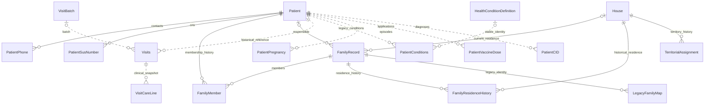

# Remodelação relacional aditiva — ACS View

Implementação local de 08/10/2026. Nenhuma tabela ou coluna legada removida; nenhuma versão pública, identidade Android, assinatura ou configuração de distribuição alterada. Não há commit ou publicação. O inventário anterior está em [relational-audit-before.md](relational-audit-before.md), produzido antes da alteração do esquema. Os testes usam somente dados sintéticos.

## Decisões e limites da evidência

- SQLite e `SQLiteAsyncConnection` permanecem. O checkout já usa `sqlite-net-base` 1.9.172 com SQLitePCLRaw 3.0.2, a mesma API de sqlite-net; não foi trocado por EF nem atualizada a dependência.
- Migrações 1–3 constituem uma transação SQLite única, com DDL, dados, validação e ledger. As versões intermediárias não ficam expostas a uma aplicação em funcionamento.
- Preservação significa que cada ocorrência de cada linha original, em suas colunas originais e tipos de armazenamento, continua existindo. Novas linhas de projeção podem ser acrescentadas. Os fingerprints incluem IDs, relacionamentos, textos, blobs e NULs; não usam `quote(TEXT)`, que truncaria NULs.
- O upgrade de credenciais já existente continua depois da migração relacional. Ele converte senhas antigas em hashes e remove os antigos segredos conforme o contrato de segurança anterior. Esse efeito intencional não faz parte de uma alegação de imutabilidade das credenciais. Nenhum parâmetro criptográfico foi trocado nesta tarefa.
- Os testes demonstram preservação nas fixtures cobertas. Não demonstram perda zero em todas as bases existentes, nem recuperam dados já eliminados por versões anteriores.
- Bases com índices únicos legados impossíveis de criar, metadados inconsistentes, corrupção ou projeções parciais divergentes falham conservadoramente. Os dados e o snapshot permanecem; não se apagam conflitos para fazer a inicialização passar.

## Auditoria e semântica anterior

`Patient.Id` e `House.CasaId` são PKs inteiras autoincrementais. `Family.IdFamilia` é uma PK global sem autoincremento; `IdPessoa` não tem contrato operacional demonstrado pelos consumidores. A UI de famílias usa `(UserId, Patient.HouseId, Patient.FamilyId)`, com número operacional por casa. A rotina de criação da UI não chama `FamilyService.SaveFamilyAsync`. Assim, `IdFamilia` não pode ser convertido automaticamente numa identidade global de família, nem `IdPessoa` considerado responsável sem outra evidência.

`HouseId/FamilyId=-1` indicam ausência; há também registros com zero. `UserId=0` indica propriedade desconhecida. `Visits.PatientId=0` admite visitas antigas sem identificação individual. `Date` é a data do evento no cadastro antigo; novas visitas atribuem `Date` e `VisitDate` à data do evento. `CreatedAt` é a criação da linha; datas antigas desconhecidas não são inventadas. `Address` permanece um snapshot textual do endereço.

Os atributos DataAnnotations em `PatientConditions` não criavam FK SQLite. A conexão real é registrada em `MauiProgram`, no diretório privado `FileSystem.AppDataDirectory`, originalmente `health_app.db`; não havia `PRAGMA foreign_keys` nem ledger persistente. Todas as conexões de produção usam esse singleton. Conexões auxiliares de backup/restauração são verificadas e não escrevem no banco ativo.

Riscos corrigidos: deduplicação destrutiva de vacinas; purga automática de visitas antigas e órfãs; backfill de responsável sem `UserId`; claim automático de dados sem dono; materialização de CNS que eliminava evidência; updates por PK capazes de trocar proprietário; limpeza de pacientes que deixava gestação e notificações para trás. O inventário também enumera consultas SQL fora dos repositórios e consumidores nas páginas/ViewModels, importação, indicadores e notificações. Não havia exportador de banco ou serviço de restauração no checkout anterior.

## Modelo



Linhas contínuas representam FKs novas reais. Linhas pontilhadas são referências legadas, preservadas sem reconstrução de tabelas; guards SQLite verificam novas referências e mudanças de vínculos. O histórico de visitas não tem exclusão em cascata.

### Tabelas criadas

| Tabela | Finalidade e regra |
|---|---|
| SchemaMigration | Version, Name, CompletedAt, PreservationDigest; só gravada após validação |
| SchemaPreservation | Inventário por versão/tabela: contagem original/final, colunas originais e digest verificado |
| FamilyRecord | Identidade independente; Id int AI, UserId, HouseId?, ResponsiblePatientId?, LocalNumber?, CreatedAt? |
| LegacyFamilyMap | Chave de origem UserId/LegacyHouseId/LocalNumber/SourcePatientId e FamilyId novo |
| FamilyMember | Id int AI, UserId, FamilyId, PatientId, JoinedAt?, LeftAt?, CreatedAt, UpdatedAt? |
| FamilyResidenceHistory | Id int AI, UserId, FamilyId, HouseId, StartedAt?, EndedAt? |
| PatientSusNumber | Id int AI, UserId, PatientId, Number, IsPrimary, OriginalOrder |
| PatientPhone | Id int AI; número original, normalizado, classificação, contato/parentesco, principal, WhatsApp, notas |
| TerritorialAssignment | Id int AI; UserId/HouseId, setor censitário e setor operacional separados, quadra, área, validade |
| HealthConditionDefinition | IDs inteiros fixos, código estável e descrição; não substitui episódios especializados |
| MigrationIssue | Evidência privada para conciliação, origem, ID, dono e código do problema |

Alterações aditivas em `House`: `IsActive`, permitindo arquivar casas referenciadas. `Patient` e `House`: `RowRevision`, para recusar edições desatualizadas. `PatientConditions`: `ConditionId` como projeção opcional do catálogo. Tabelas antigas recebem apenas campos ausentes necessários ao modelo já utilizado pelo aplicativo. Datas nullable usam ticks BIGINT compatíveis com a conexão existente. Não foram introduzidas tabelas de ruas, bairros ou municípios.

### Restrições efetivas

`Patient(Id,RelationalOwnerId)` e `House(CasaId,RelationalOwnerId)` recebem índices únicos compostos. RelationalOwnerId é uma coluna virtual gerada por COALESCE(UserId,0): mantém intacto até um UserId SQL NULL deixado por uma expansão antiga e representa essa propriedade desconhecida como zero nas projeções. Não é atribuição a uma conta. Todas as FKs novas usam a identidade e o proprietário juntos, com `RESTRICT`. Não há FK para `User` nas projeções: isso permite preservar registros sem proprietário ou usuários antigos ausentes sem inventar contas. As APIs exigem conta autenticada para novas operações.

Há índices parciais únicos para membro ativo por paciente, residência vigente por família, atribuição territorial ativa por casa, telefone principal e CNS principal por paciente. `(PatientId,Number)` é único para CNS; `(PatientId,NormalizedNumber)` é único para telefones. Números incompletos têm normalização nula e permanecem com texto original, sem colisões fictícias. A normalização telefônica compara dígitos de 8–15 posições; não presume país nem acrescenta DDD. Pessoas diferentes podem compartilhar o mesmo número.

Triggers impedem troca de `UserId` nas entidades escopadas e validam novas referências de paciente, casa, responsáveis, batch, linha de cuidado e CID. Vínculos inválidos antigos não são apagados; mudanças em campos não relacionados continuam possíveis. A exclusão direta de um paciente com histórico clínico/visitas é recusada. A operação individual da UI arquiva o paciente; a limpeza voluntária de dados continua explicitamente destrutiva e escopada por conta.

## Mapeamento e autoridade durante a compatibilidade

| Origem | Destino / tratamento |
|---|---|
| Patient.Id, House.CasaId | IDs preservados integralmente |
| Patient.SusNumber | Coluna original autoritativa para edição/importação; projeção PatientSusNumber segue SusNumberSet, com ordem e principal |
| CNS inválido/duplicado | Texto original intacto; MigrationIssue conserva evidência; compartilhamento não funde pacientes |
| UserId/HouseId/FamilyId válido | Uma FamilyRecord por grupo de origem; LegacyFamilyMap mantém a correspondência |
| FamilyId sem casa válida | Família separada por paciente de origem; não se unem grupos por número sem residência conhecida |
| Family.IdFamilia/IdPessoa | Tabela intacta e issue LegacyFamilyUnresolved; sem inferência destrutiva |
| Responsável | ID explícito único que pertence ao grupo; na ausência de ID, CNS explicitamente informado que identifica um único membro; nunca coincidência de nomes |
| Associação familiar existente | JoinedAt=null; CreatedAt é o momento de materialização, não ingresso histórico |
| Residência existente | StartedAt=null; alterações futuras fecham a linha anterior e criam uma nova |
| UserId=0 | Mantido em quarentena; autenticação não é prova de propriedade |
| Vaccines booleano | Aplicação sem AppliedAt e sem data de criação inventada; flag antiga fica intacta |
| PatientVaccineDose duplicado | Todos os IDs, datas, lotes e notas preservados; edição/remoção pelo seletor de dose é bloqueada até conciliação |
| PatientConditions | Descrição intacta, catálogo estável opcional; insulinodependência, Bolsa Família e gestação continuam separados |
| BolsaFamilia booleano antigo | Consumido uma vez em migração versionada, sem limpar a flag antiga; não ressuscita benefício removido ao reiniciar |
| Visitas e CIDs órfãos | Preservados e sinalizados; não se fabricam pacientes para corrigir referências |

A leitura do cadastro atual ainda usa os campos legados como fachada compatível com filtros, DTOs, dashboards, sugestões, notificações e importações. Isso é deliberado nesta fase. Novos episódios familiares e de residência são autoritativos nas tabelas de histórico. Toda escrita de Patient pelo repositório mantém a projeção CNS/familiar na mesma transação. FamilyManager faz inclusão, remoção, remoção de família e transferência de residência atomicamente. A transferência mantém a mesma FamilyRecord e os mesmos membros; atualiza o número operacional da casa de destino e conserva os mapeamentos históricos. Um número histórico já transferido não pode ser silenciosamente reutilizado para outra família; GetMaxId inclui os mapeamentos anteriores.

Updates de Patient/House comparam RowRevision antes de gravar. Somente campos efetivamente editados são escritos; mudanças familiares usam SQL limitado aos vínculos. Isso evita que defaults C# substituam datas nulas ou textos legados não editados. Triggers incrementam a revisão também nas alterações SQL diretas.

`IRelationalDataService` expõe contatos, CNS, histórico familiar/residencial, classificação territorial e conciliação da conta atual. `IDatabaseBackupService` cria snapshots e prepara restaurações para a próxima inicialização. Não se acrescentou um novo editor visual de contatos, território ou conciliação nesta entrega: são APIs operacionais testadas, sem reformulação desnecessária das telas. A conciliação de propriedade dos dados `UserId=0` permanece deliberadamente pendente de comprovação explícita; não existe uma ação automática que os atribua à conta logada.

As consultas de visitas usam o mapeamento histórico da casa/número para localizar a identidade familiar, sem depender da família atual do paciente. Nomes de responsáveis não eram snapshots no modelo anterior; não se inventa um nome histórico. Address, IDs e datas originais permanecem. Novos batches e linhas de cuidado são gravados em transação; falhas não deixam batches órfãos. As chamadas existentes de PurgeExpiredVisitsAsync permanecem por compatibilidade, mas não apagam eventos.

`LegacyDateSql` lê timestamps TEXT gerados por migrações antigas como datas de calendário em vacinas/gestações, sem regravar o armazenamento original. A precisão de apresentação de strings fracionárias segue o parser SQLite (milissegundos); os bytes originais continuam preservados. CreatedAt de doses é nullable; uma aplicação comprovada sem data permanece aplicada na UI, com ApplicationDate=null, sem usar criação como data de aplicação. Edições clínicas não regravam CreatedAt. Encerrar um episódio gestacional não encerra outro; retirar genericamente a condição com múltiplos episódios ativos exige conciliação. Datas de nascimento nulas são sinalizadas e não geram classificações etárias fictícias nos snapshots de visitas.

A única inclusão visual necessária é o controle “Data de aplicação conhecida” no editor de vacinação, acompanhado da indicação de data desconhecida. Editar lote/observação de uma dose antiga sem data não converte o default do DatePicker em uma data histórica fictícia. O ViewModel real desse editor é exercitado nos testes; renderização e interação nativa ainda dependem de validação no aparelho.

### Exclusões

- Paciente individual: arquivamento com IsActive=false, preservando cadastro e histórico; pode ser encontrado pelo filtro de inativos.
- Casa individual: encerra ocupação vigente e vínculos atuais; mantém a casa arquivada quando há eventos/históricos referenciados.
- Limpeza de casas da conta: arquiva casas, encerra histórico vigente e desassocia pacientes, sem purgar visitas.
- Limpeza de pacientes da conta: remove explicitamente contatos, projeções, história familiar, gestação, vacinas, condições, notificações e visitas antes dos pacientes.
- Limpeza completa da conta: acrescenta casas/território e notas. Os demais usuários e dados sem proprietário não são incluídos.
- Snapshots são cópias privadas integrais de recuperação, inclusive dados posteriormente removidos do banco ativo. Não são automaticamente purgados por uma limpeza seletiva, pois também contêm as outras contas. Sua política de retenção precisa ser resolvida antes da distribuição se a exclusão exigida incluir todas as cópias históricas.

## Migrações

1. `legacy-expand`: criação/adaptação das tabelas existentes, defaults conservadores em campos novos, busca normalizada em colunas novas, preparação das chaves compostas; remoção somente do índice que impedia aplicações históricas distintas de vacina.
2. `relational-expand`: DDL explícito com FKs reais, índices parciais, guards e tabelas de conciliação.
3. `relational-backfill`: CNS, famílias/membros/residências, vacinas booleanas, flags antigas de Bolsa Família, catálogo clínico e diagnóstico de referências inválidas.

`PRAGMA user_version=3` e SchemaMigration identificam o esquema. Ledger não contíguo é rejeitado. Inicialização concorrente relê a versão sob a transação. O rollback inclui DDL, dados e metadados. Reinício não reaplica backfills nem apaga doses. Não há dependência de internet para migrar; CEP externo não é necessário quando a importação contém endereço suficiente.

`PRAGMA integrity_check` e `foreign_key_check` são executados antes/depois. Só são registradas versões aprovadas. Projeções de CNS e associação ativa são verificadas também na abertura do esquema atual. Isso detecta divergências em vez de escondê-las.

## Backup, restauração e downgrade

O snapshot usa `SQLiteAsyncConnection.BackupAsync`, que chama o mecanismo SQLite de backup consistente, não uma cópia de arquivo em uso. Há verificação de espaço, abertura read-only do destino e testes de integridade. Referência: [SQLite Online Backup API](https://www.sqlite.org/backup.html).

Os snapshots ficam em `migration-backups` ao lado do banco privado, com nomes únicos `pre-migration-<UTC>-<GUID>.db`. Não são emitidos dados pessoais para logs. Arquivos .db, .sqlite, WAL/SHM e APK já são ignorados pelo Git. Nunca anexar snapshots reais a issues ou documentação.

Procedimento técnico de recuperação:

1. Identificar o banco selecionado por `DatabaseRecovery.GetSelectedDatabasePath(FileSystem.AppDataDirectory)`. Sem seleção, é health_app.db.
2. Preservar o original e todas as cópias de recuperação. Não copiar apenas um .db ativo ignorando WAL/SHM.
3. Usar `IDatabaseBackupService.StageRestoreForNextStartAsync(snapshot)` para abrir/validar a origem read-only, copiar pela API de backup para um novo `health_app-restored-<GUID>.db` e migrar/validar essa cópia.
4. Somente após sucesso, um arquivo temporário de seleção é renomeado atomicamente para `database-selection.txt`, no mesmo diretório privado. A conexão ativa não é substituída.
5. Reiniciar o processo. A fábrica abrirá a nova cópia. Seleção inválida ou arquivo ausente falha em vez de criar um banco vazio.
6. Autenticar novamente com senha. Sessões e grants biométricos são vinculados ao caminho do banco e não atravessam uma restauração com IDs/revisões coincidentes. A inscrição biométrica pode ser refeita depois do login. Hashes, senhas e parâmetros criptográficos continuam intactos.
7. Para voltar ao original, com o aplicativo completamente fechado, guardar/remover somente o arquivo de seleção e reabrir com uma versão compatível. O original nunca foi substituído pelo mecanismo de restauração.

Um aplicativo com este migrador recusa bancos com user_version superior ao suportado antes de alterá-los. Binários antigos já distribuídos, que não verificam versão, não podem ser corrigidos retroativamente por este código. Não abrir a base expandida com esses APKs; para downgrade, restaurar um snapshot anterior em uma instalação compatível. Distribuição permanece condicionada a uma política de bloqueio de downgrade e retenção de snapshots. Não há alegação de que qualquer APK histórico externo agora obedeça ao ledger.

## Validação e arquivos

`Tests/ACSView.MigrationTests` usa os serviços e repositórios reais, substituindo apenas planilha já decodificada, CEP externo e scheduler de SO. A suíte de importação existente também testa o leitor de planilhas e os contratos de importação. `ACSView.AuthTests` usa o AuthService e SQLite reais, com vault e biometria de SO simulados.

Comandos:

```powershell
dotnet restore 'ACS View.csproj' -p:TargetFrameworks=net10.0-android --ignore-failed-sources
dotnet build 'ACS View.csproj' -f net10.0-android -c Debug --no-restore
dotnet build 'ACS View.csproj' -f net10.0-android -c Release --no-restore
dotnet run --project Tests/ACSView.MigrationTests/ACSView.MigrationTests.csproj
```

Executar também as suítes Tests, ImportTests, AuthTests, BolsaFamiliaTests, ReminderTests e SessionTests. Resultados finais e matriz dos 30 casos: [relational-validation.md](relational-validation.md).

Arquivos centrais: SchemaMigrator (versionamento/preservação), DatabaseRecovery/DatabaseBackupService (recuperação), RelationalStore (DDL/backfill/projeções), RelationalRecords (entidades), SQLitePatientRepository/SQLiteHouseRepository/SQLiteConditionsRepository, FamilyManager/FamilyService, DatabaseService, VisitsService/VaccineService/PregnancyService, LegacyDateSql, UserDataCleanupService, DashboardMetricsService, AuthService, interfaces, DI/MauiProgram e FamiliesViewModel. DTOs/ViewModels de vacinação e VaccineApplicationPopup preservam aplicação sem data conhecida. Não foram modificadas telas para fins estéticos. A alteração local concorrente em Views/FamiliesPage.xaml foi preservada e não pertence à remodelação.

## Retirada futura do legado

Manter Patient.SusNumber/HouseId/FamilyId/FamilyResponsibleSus, Family.IdFamilia/IdPessoa, Vaccines, flags BolsaFamilia e todas as colunas históricas de Visits. Não remover Note, CareNotification, PatientInsulinDependency, episódios gestacionais ou catálogos CID.

Antes de uma contração: resolver propriedade e ambiguidades com confirmação explícita, disponibilizar conciliação/exportação administrativa necessária, mudar os consumidores para identidade familiar independente e coleções normalizadas como fonte primária, validar todos os bancos suportados em cópias protegidas, verificar dispositivos/backup/downgrade, então projetar uma migração separada de remoção com recuperação demonstrada. Esta entrega não realiza essa contração.
